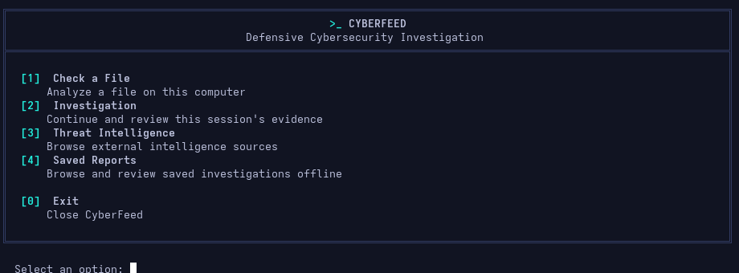
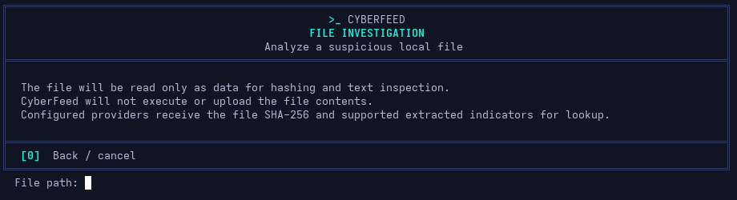
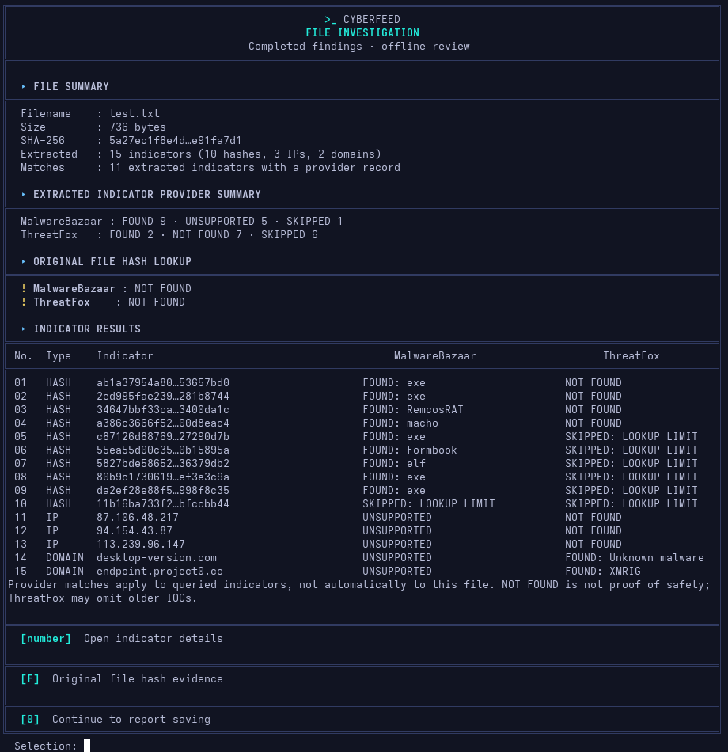
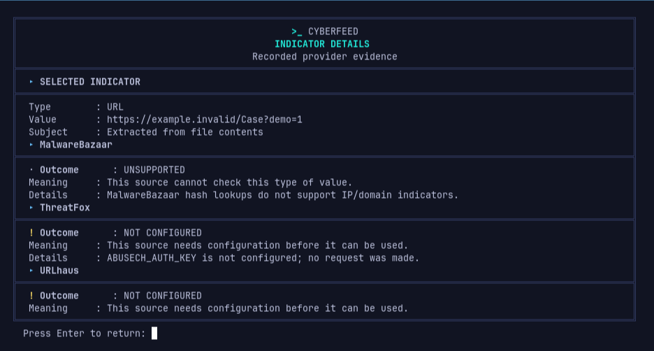
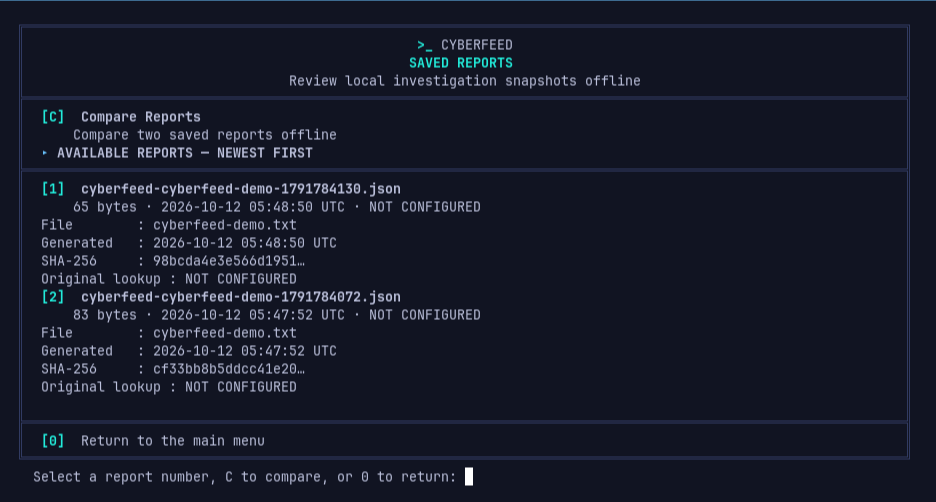
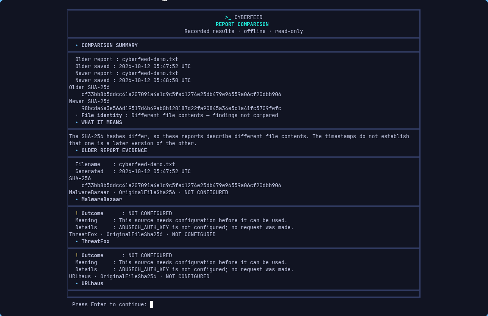
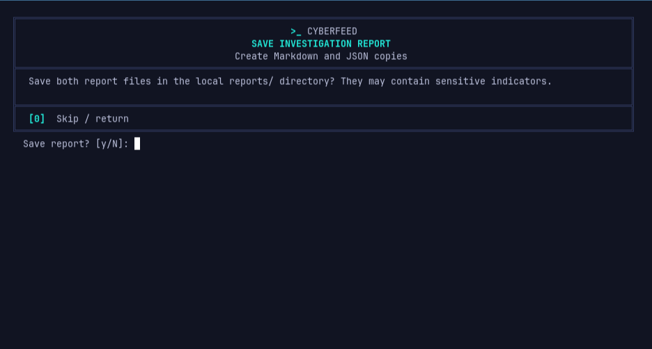

# CyberFeed

CyberFeed is a Rust-based defensive threat-intelligence investigation CLI. It starts with a local file or an indicator, gathers related evidence from local inspection and selected public intelligence sources, and keeps the results available for review without treating them as an automatic malware verdict.

## Screenshots

**Main menu**



**File input**



**Completed investigation**



**Indicator evidence**



**Saved reports**



**Report comparison**



**Report save prompt**



*The investigation, details, report list, and comparison screenshots use reports created by the application from a harmless local sample containing a reserved `.invalid` URL. Provider credentials were absent, so no provider requests were made. The report browser reads saved JSON reports locally and compares them offline.*

## Features

- Inspect a local file as data, calculate its SHA-256 with streamed reads, and extract unique MD5, SHA-1, and SHA-256 hashes, IP addresses, domains, and HTTP/HTTPS URLs from readable text.
- Query MalwareBazaar, ThreatFox, and URLhaus for the indicator types each supports. URLhaus accepts exact URLs, IPv4/domain/hostname host queries, and MD5/SHA-256 payload hashes. Duplicate provider queries do not cause duplicate requests.
- Browse MalwareBazaar recent-sample feeds with optional country filtering, or view Cloudflare Radar Layer 7 attack telemetry.
- Follow live file-lookup progress, review provider outcomes, page through indicators, and open detailed recorded evidence.
- Resize the terminal while CyberFeed is open; the active screen redraws and the current prompt text is retained.
- Save paired Markdown and JSON file-investigation reports, browse reports, and compare saved investigations offline when they refer to the same file SHA-256.
- Run an offline demo and local setup diagnostics from the main menu; diagnostics report credential presence only and do not contact providers.
- Batch inspect up to 100 selected files or one directory level at a time, saving a local report per readable file. Batch mode performs local extraction only.
- Export locally extracted IP, domain, URL, and common hash indicators from a saved report as a STIX 2.1 JSON bundle. The export describes observed indicators and makes no file-maliciousness claim.
- Hunt ordinary UTF-8 text and JSON Lines logs incrementally, retaining line numbers and bounded context for each occurrence. This is format-agnostic token extraction, not vendor-specific parsing.

## How an investigation works

1. Choose **Check a File** and enter, paste, or drag in a path. CyberFeed reads the file locally, hashes it, and scans readable text for supported indicators; it never executes the file.
2. Review the original file hash separately from indicators extracted from its contents. When configured, the relevant provider receives the hash or supported indicator value for lookup; file contents are not uploaded.
3. Inspect provider outcomes and available match metadata, then optionally save the evidence as a report.

`NOT FOUND` means that a provider returned no record for that query; it is not proof of safety. Provider errors, unsupported values, missing configuration, and skipped lookups remain distinct outcomes. A match describes the queried indicator and does not by itself establish that the source file is malicious.

A **hash** is a fixed-length fingerprint of file contents; an **indicator** is a value such as a hash, address, domain, or URL that can be checked against public records. A provider lookup is a query to one of those sources. When comparing reports, a matching file SHA-256 means both reports describe the same contents. Different hashes describe different contents and do not show which file came first. A newly recorded provider match is new evidence in the report, not proof that a threat appeared between the reports; missing or failed checks do not prove that a record or threat disappeared.

## Requirements and installation

Install Rust and Cargo with support for the Rust 2024 edition. From a checkout, build and start CyberFeed with:

```sh
git clone https://github.com/Reon-1/Cyberfeed.git
cd Cyberfeed
cargo run
```

No provider credentials are required for local inspection or offline report browsing.
The CI workflow runs formatting, compilation, tests, and Clippy on stable Rust for Linux, macOS, and Windows. This checkout has been validated locally on Linux; the other jobs must pass before those platforms are considered verified.

## Configuration

CyberFeed reads optional credentials from environment variables or a local `.env` file. The repository's `.env.example` contains placeholders; keep real values in your private `.env`, which is ignored by Git.

Use **More Tools → Configure Providers** to add, replace, or remove credentials without editing the file manually. Input is hidden, and CyberFeed never tests credentials automatically. Saving requires confirmation because `.env` stores plaintext secrets. On Unix the file is created with owner-only permissions; Windows file ACLs follow the current account and are not explicitly hardened by CyberFeed. Restart after a change. Environment variables supplied outside `.env` take precedence over saved values.

| Variable | Provider |
| --- | --- |
| `ABUSECH_AUTH_KEY` | Shared by MalwareBazaar, ThreatFox, and URLhaus |
| `CLOUDFLARE_API_TOKEN` | Cloudflare Radar, configured independently |

If a provider's credential is absent, its lookup is recorded as not configured. See the official [MalwareBazaar API](https://bazaar.abuse.ch/api/), [ThreatFox API](https://threatfox.abuse.ch/api/), [URLhaus API](https://urlhaus-api.abuse.ch/), and [Cloudflare Radar API](https://developers.cloudflare.com/radar/) documentation.

## Using the menus

- **Check a File** starts local inspection and provider lookups. Use the displayed number to open indicator evidence, `N`/`P` to change overview pages, `F` for the original file's hash result, and `0` to continue to the report-saving prompt.
- **Current Session** lets you check a hash, IP address, domain, or HTTP/HTTPS URL and review evidence collected in this session. Actionable diagnostics explain rejected formats (such as unsupported hash lengths or malformed URLs/domains).
- **More Tools** groups the offline demo, setup check, provider configuration, batch file check, and optional live threat feeds so the main menu stays short.
- **Saved Reports** browses local report snapshots and offers **Compare Reports** when at least two valid reports are available.
- The main menu uses `1`–`5`; choose `0` to exit. Submenus use `0` to go back. At prompts, use the arrow keys to edit or browse input history, `Tab` to complete file paths, and `Ctrl+C` to return from the current prompt. Credential entry is hidden; `Esc` or `Ctrl+C` cancels it. Resizing redraws the active screen without submitting input.
- **Offline Demo** shows explicitly simulated training data without network access. **Check Setup** reports credential presence (not authentication) and report-directory access. **Configure Providers** edits the two supported `.env` keys with hidden input and confirmation. **Batch Check Files** accepts semicolon-separated paths or one directory (non-recursive), inspects at most 100 files, and saves a report per readable file without running lookups.
- File investigations open a **Quick Summary** first. Choose `D` to review detailed indicator and provider evidence from the same recorded results, then `0` to continue to the report-saving prompt.
- **Search Logs** accepts UTF-8 text or JSONL input and streams at most 64 MiB, 16 KiB per line, 1,000 unique indicators, and 10,000 source occurrences. It stores line numbers and context in the usual JSON/Markdown report pair. Log hunting currently performs no provider enrichment.
- In a saved report view, enter `S` to write a STIX 2.1 bundle under `reports/stix/`. Unsupported or malformed indicator values are omitted.

An optional independent STIX check can be run after installing the OASIS validator separately: `pip install stix2-validator`, then `stix2_validator reports/stix/<bundle>.stix.json`. CyberFeed's automated tests do not require this tool; external validation has not been performed as part of the build.

## Reports, privacy, and limits

Choosing to save a file investigation writes a JSON and a Markdown report under `reports/` relative to the current working directory. Reports contain the file's name, size, SHA-256, extracted indicators, and recorded provider evidence. File evidence stays in the current session unless that file report is saved. Saved reports can be browsed and compared offline; manually added session indicators are not automatically included in file reports. Reports can contain sensitive indicators and hashes, so keep them private.

On Unix, report files are created with owner-only read/write permissions. Saved JSON reports larger than 32 MiB are marked unavailable by the report browser; the size is enforced while reading, not only from file metadata.

The file itself is not sent to providers. Configured lookups send the original file SHA-256 and supported extracted indicator values to the relevant API. When an IP endpoint with a port (such as `185.112.146.10:8080` or `[2001:db8::1]:8080`) is encountered in file text, CyberFeed extracts the underlying host IP address for lookup; passive threat-intelligence providers index indicators by IP address, not transport port, and CyberFeed records the queried IP indicator rather than claiming an exact IP-and-port lookup was performed. MalwareBazaar checks MD5, SHA-1, and SHA-256 hashes; its successful response bodies are capped at 16 MiB. ThreatFox accepts MD5 and SHA-256 hashes, IP addresses, domains, and exact full HTTP/HTTPS URLs using `search_ioc` with `exact_match: true` (SHA-1 is unsupported). URLhaus uses the shared `ABUSECH_AUTH_KEY`: its exact URL endpoint checks the complete URL including path/query, its host endpoint discovers URLs associated with an IPv4 address or domain/hostname, and its payload endpoint accepts MD5 or SHA-256 (not SHA-1). Exact URL lookups and host lookups are distinct observations. URLhaus returns at most 100 associated URL records per host response; each response body is limited to 1 MiB, and extracted URLs are limited to 2,048 bytes. MalwareBazaar and ThreatFox each have a ten-unique-lookup automatic cap per file; URLhaus file investigations have a ten-request overall cap. A round-robin scheduler reserves at most four payload-hash calls (including the original file SHA-256), three explicit-host calls, three exact-URL calls, and three URL-derived-host calls; identical host endpoint requests are deduplicated across explicit and URL-derived sources. The original file hash uses one slot for each applicable provider, duplicate queries are suppressed, and unqueried values are reported as skipped rather than not found. Local extraction is capped at 10,000 total indicators and 1,000 URLs, with the first reached cap stopping extraction. URLhaus focuses on malware-distribution URLs and is not a universal domain/IP reputation service. Offline URLs remain historical evidence. Provider availability and public-data coverage vary; a no-match result is not proof of safety, and an API failure is not a no-match result.

## Project structure

- `src/app/` coordinates menus, file investigations, provider views, and saved-report navigation.
- `src/file.rs`, `src/indicator.rs`, and `src/investigation.rs` handle local inspection, classification, and collected evidence.
- `src/providers/` contains the MalwareBazaar, ThreatFox, URLhaus, and Cloudflare clients; each module owns its provider request and response parsing.
- `src/report/` models, renders, and stores reports; `src/ui.rs` and `src/app/terminal.rs` provide terminal presentation and input.


Within file investigations, `src/app/file_workflow/lookups.rs` owns provider request scheduling, automatic lookup limits, deduplication, and conversion into the shared recorded-outcome model. The surrounding workflow handles terminal interaction and report prompts. A new lookup provider should keep its request format and parsing in its provider module, then map its result into the shared evidence outcomes at this workflow boundary; existing providers share the abuse.ch key but keep distinct request and response handling.

## Development

```sh
cargo fmt --check
cargo check --all-targets
cargo test
cargo build
cargo clippy --all-targets --all-features -- -D warnings
git diff --check
```

Tests use deterministic local data and do not require credentials or live provider requests.

For a manual smoke test, configure your private `.env` with `ABUSECH_AUTH_KEY`, run `cargo run`, then choose **Investigation → Add indicator** and try one hash, IP/domain, and complete HTTP/HTTPS URL from your own test material. Results reflect current provider data; no positive outcome is expected, and the application does not fetch submitted URLs or upload files.
